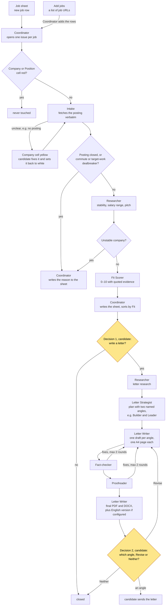
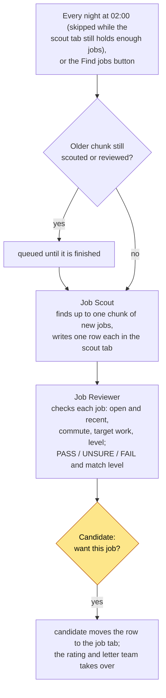

# Jobject: job application agents

Two teams of AI agents on [Paperclip](https://github.com/paperclipai/paperclip). The **scouting team**
finds new job postings that fit the candidate and lists them, reviewed, in its own tab of the
candidate's Google Sheet. The **rating and letter team** rates the postings in the candidate's job tab
and drafts cover letters for the ones they want to apply to. Agents never submit anything; the
candidate picks the jobs, reviews the letters and sends applications themselves.

## Rules in git, personal data only on your machine

The repository holds only the generic mechanics: agent instructions, the sheet contract, scripts and
config. **Everything about the person looking for a job lives only in two gitignored folders:**

- `documents/`: CVs, references (Arbeitszeugnisse), certificates, the profile (`about-me.md`), the
  tunable job-search parameters (`job-preferences.md`: commute limits, location score, target work,
  dealbreakers, bonuses, salary pitch, letter rules, sheet id and column map), the job searches
  (`search.json`), the letter sender block
  (`sender.json`) and the home location for the commute check (`commute-home.json`).
- `jobs/`: one folder per job with the posting, ratings, research and letters.

Agent instructions never contain a personal value; they point at the section of the file that holds
it (e.g. "apply the limits in `documents/job-preferences.md` §Commute"). `documents.example/` is the
committed, blank copy of `documents/` that shows exactly which files the agents expect and how they
must look.

## Setup: your personal data

1. `cp -r documents.example documents` (`documents/` is gitignored; never commit it).
2. Fill in every file; `documents/README.md` (copied from the example) explains each one:
   - `about-me.md`: profile, consistency facts, proof points, availability, writing preferences
   - `job-preferences.md`: your commute limits, location scores, target work, dealbreakers, bonuses,
     salary pitch policy, letter rules, and **your sheet**: spreadsheet id, tab names (open jobs, plus
     the read-only tabs you move applied and rejected rows into), header row and the column map (your header text for each column role and what agents may write)
   - `sender.json`: the sender block printed on every letter
   - `commute-home.json`: your home coordinates, whether you have an e-bike, and the commute limits
     in minutes (keep them in sync with `job-preferences.md` §Commute)
3. Put your CVs into `documents/cv/`, references into `documents/references/` and certificates into
   `documents/certificates/`, then add plain-text transcriptions to `documents/text/` (CVs with
   numbered lines `L1`, `L2`, …) and list them in `documents/text/README.txt`, including which
   document is the main proof for your target work.
4. Create the Google Sheet (or use yours), put its id and tab names into `job-preferences.md` §Sheet,
   and connect the claude.ai Google Sheets connector on the Claude account the agents use.
5. Start the instance and provision the agents (see Running).

## How it works



The three dealbreakers, and nothing stricter (the values come from `documents/job-preferences.md`):

- **Commute:** a limit per onsite frequency (e.g. stricter for 3+ days a week than for 1–2 days,
  none for monthly or remote), measured one way from home (`commute-home.json`), as the faster of
  public transport and, if you have one, an e-bike. Unclear onsite rules never reject.
- **Target work:** only when the job lacks the work the candidate is looking for (defined in
  §Target work). A title keyword is never a reason to reject; it only lowers the score if the work
  itself doesn't match.
- **Unstable company:** only on concrete evidence (insolvency, restructuring proceedings, acute money
  trouble). Layoffs alone are a watch flag, not a rejection.

Letters land in `jobs/<company>_<position>/final/<Angle>/`, one folder per angle named after
how it presents the candidate (e.g. `final/Builder/`, `final/Leader/`), each with
`<Firstname>-<Lastname>-Anschreiben` (German) and, if configured, `<Firstname>-<Lastname>-Cover-Letter` (English) as `.pdf` and
`.docx`, named after the candidate (`documents/sender.json`). File names never carry the company, a variant letter or a
language tag, so they can be sent as they are.

| Agent | Job |
|---|---|
| Coordinator | syncs the sheet when the candidate starts it (scripts/sync-spreadsheet.sh or the "Sync now" button), opens one issue per job, adds rows from the candidate's URL lists, colours unclear rows yellow, writes results back (plus Location / Languages / Work mode), sorts rows by Fit, asks the candidate for decisions |
| Intake | fetches the posting verbatim, checks it is still open, runs the commute gate (limits per onsite frequency from job-preferences.md) and the target-work gate |
| Researcher | stability gate (insolvency, restructuring, acute money trouble; layoffs = watch only), salary range + pitch, letter research |
| Fit Scorer | 0–10 rating with evidence quoted from the posting; role level, location score and bonuses from job-preferences.md |
| Letter Strategist / Writer | letter plan with two named angles (e.g. Builder / Leader), one draft per angle of one A4 page each, optional English version of each German letter |
| Fact-checker / Proofreader | every claim checked against the candidate's documents; language review (max 2 rounds each) |

Rules live in `agents/_shared/WORKFLOW.md` (process) and `agents/_shared/SHEET.md` (sheet contract).

## Finding jobs: the scouting team



| Agent | Job |
|---|---|
| Job Scout | one chunk per run (size, posting age, searches: `documents/search.json`): job boards (Arbeitsagentur, Arbeitnow, StepStone), web search for employers' own postings, careers pages of the candidate's target companies; nearest jobs first, actual employers before recruiters, never LinkedIn or aggregator copies, nothing the candidate already has in a tab |
| Job Reviewer | independent check of the chunk from the saved postings: still open and recent, commute limit, target work, level, formal requirements; writes verdict, match level, commute and notes |

Built to use few tokens: `scripts/scout.py` does the searching, age and title filtering, duplicate
check, page saving and queueing without a model; both agents run on Sonnet, read only their own short
rules (`agents/_shared/SCOUTING.md`), work on one issue per chunk and do no stability or salary
research (the rating team does that for the jobs the candidate picks). The candidate's choices are in
`documents/job-preferences.md` §Search and `documents/search.json`.

The team learns from what the candidate does with its rows: before each search `scout.py feedback`
logs every scouted job as accepted (moved to the job or applied tab), denied (a red cell, or the
rejected tab) or deleted, and the Job Scout keeps the patterns in `jobs/scout/learned.md`, which both
agents use to skip or rank jobs; denied and deleted jobs never come back, and the hard rules in
`job-preferences.md` always win.

## Layout

```
agents/             one AGENTS.md per agent + _shared/ (workflow, sheet contract, agent ids)
config/             Claude account (one file) + per-agent permission allowlists (generated)
scripts/            instance, provisioning, commute check, page fetch, letter rendering, folder sync, job scouting
templates/          Paperclip instance config
plugins/            Dashboard "Sync now" button
documents.example/  blank templates of every personal file, committed: copy to documents/
documents/          PERSONAL: CVs, references, profile, job preferences, sender block   (gitignored)
jobs/               one folder per job: <company>_<position>/ (+ .ticket); scout/ = scouted chunks   (gitignored)
paperclip/          copy of the Paperclip server                                       (gitignored)
```

`documents/` and `jobs/` exist only locally.

## Running

```bash
pnpm dev                               # = scripts/instance.sh start (also: pnpm stop / restart / status / url)
scripts/instance.sh start              # own instance on :3300 (never touches other Paperclip instances)
scripts/provision.sh                   # agents, permissions, sheet-sync routine (no schedule), find-jobs nightly at 02:00 (idempotent)
scripts/sync-spreadsheet.sh            # sheet sync now: new rows, fill columns, stages, fit ranking
scripts/sync-now.sh                    # full refresh now (same as the "Sync now" Dashboard button)
scripts/find-jobs.sh                   # scout one chunk of new jobs now (same as the "Find jobs" Dashboard button)
scripts/watch-jobs.sh [JOB-N ...]      # operator: watch jobs until back, restart stuck ones (DRY_RUN=1 to only report)
plugins/sync-button/build.sh           # build + install the Dashboard buttons plugin ("Sync now", "Find jobs")
python3 -I scripts/gen-settings.py     # regenerate permission allowlists after changing them
scripts/switch-claude-account.sh ~/.claude-other   # move all agents to another Claude account
```

Requirements: Node 22 + pnpm (Paperclip), Google Chrome (page fetch, PDF), `pdftotext`/`pdfinfo`,
the claude.ai Google Sheets connector on the Claude account the agents use.

## History

Built 2026-11-11 to 2026-11-13: initial team; permission fixes (API wrapper, no operator hooks in
agent runs); evidence-only fit rubric with configurable bonuses; review by four independent reviewer
agents and the fixes from it (bounded review loop, verbatim postings, one-page letters, closed-posting
and eligibility checks, tighter permissions); a main-proof reference document; English versions of
German letters; folders by sheet row; yellow "waiting for the candidate" cells; Fit-sorted sheet;
salary range + pitch; header-based columns; location preference score. 2026-11-16: commute limit by
onsite frequency; all personal values moved out of the committed files into the gitignored
`documents/` (with blank templates in `documents.example/`); scouting team (Job Scout, Job Reviewer)
with its own sheet tab, a nightly run at 02:00 and a "Find jobs" button.
